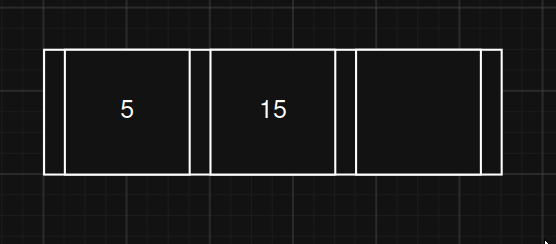
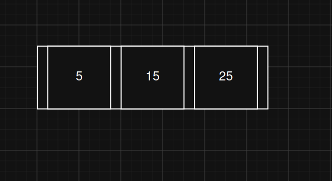
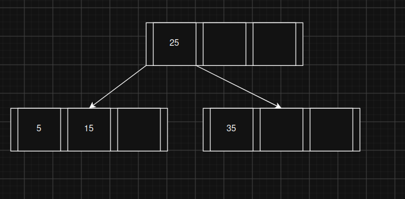
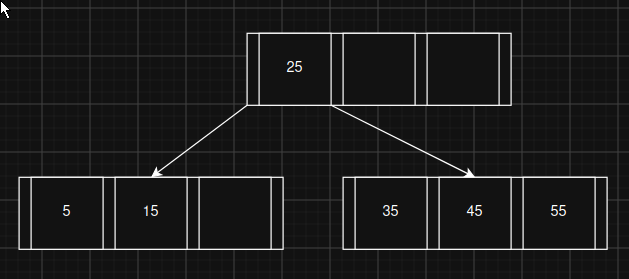
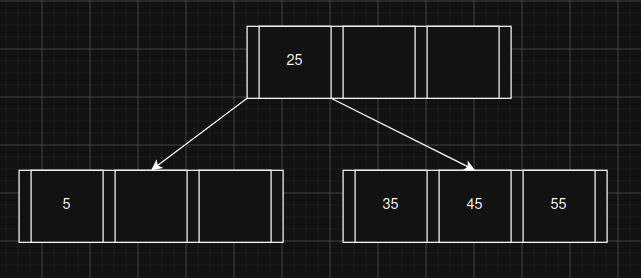
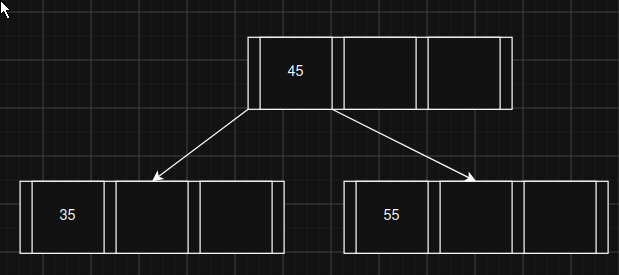
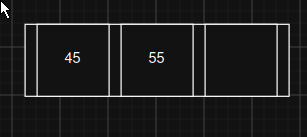

# Exercicio - Considere uma Árvore B de ordem 4 inicialmente vazia.

## Questão A)

Insira as seguintes chaves em ordem:

- [15, 5, 25, 35, 45, 55]

> Inserir 15

> Inserir 5

> Inserir 25

> Inserir 35

> Inserir 45

> Inserir 55

## Questão B)

Remova as seguintes chaves, após as inserções da questão A)

- [15, 25, 5, 35]

> Remover 15

> Remover 25

> Remover 5

> Remover 35
