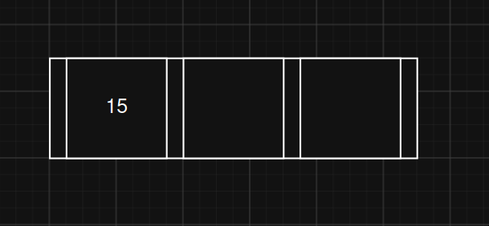
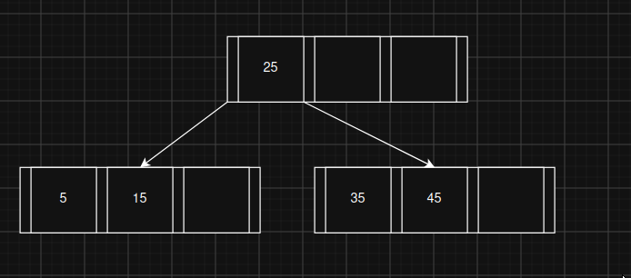
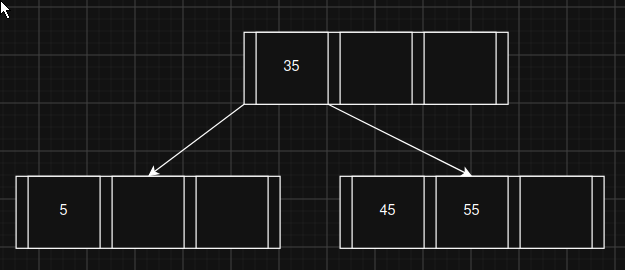

# Exercicio - Considere uma Árvore B de ordem 4 inicialmente vazia.

## Questão A)

Insira as seguintes chaves em ordem:

- [15, 5, 25, 35, 45, 55]

## Questão B)

Remova as seguintes chaves, após as inserções da questão A)

- [15, 25, 5, 35]

