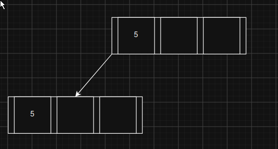
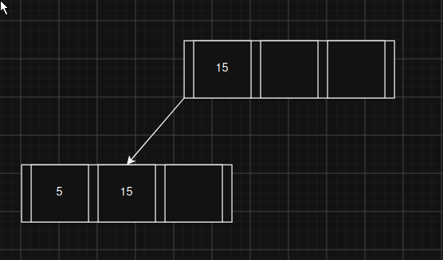
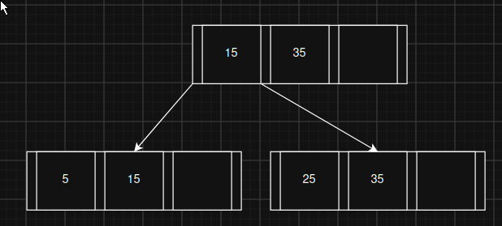
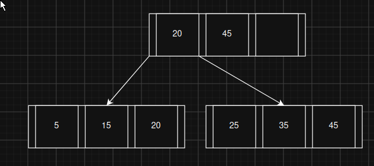

# Exercicio - Considere uma Árvore B+ de ordem 4 inicialmente vazia

## Questão A)

Insira as seguintes chaves em ordem.

- [5, 15, 25, 35, 45, 20, 30, 10, 50, 40]

> Inserir 5

> Inserir 15

> Inserir 25

> Inserir 35

> Inserir 45

> Inserir 20

> Inserir 30

> Inserir 10

> Inserir 50

> Inserir 40

## Questão B)

- [45, 25]

> Remover 45

> Remover 25
