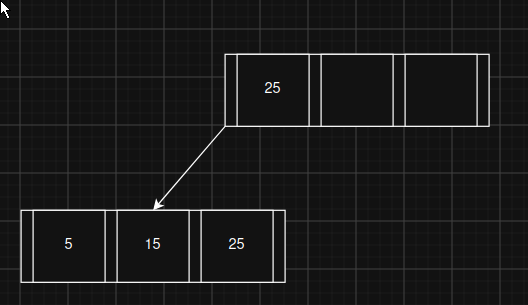
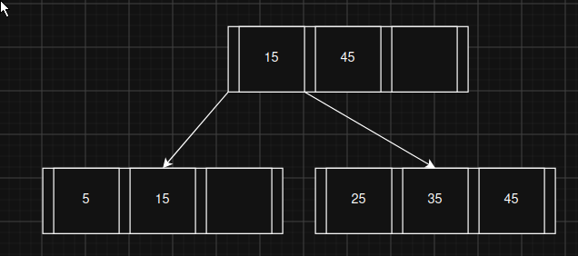
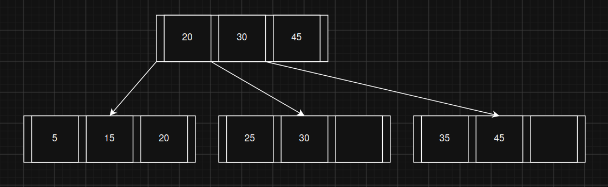
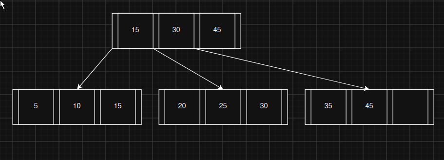
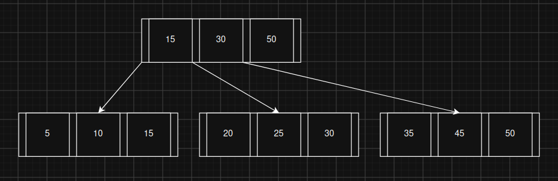
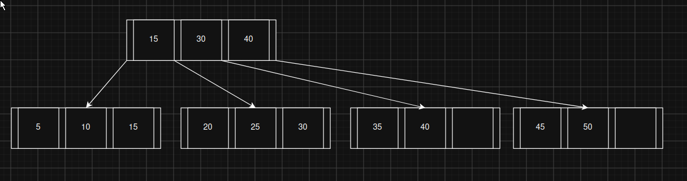
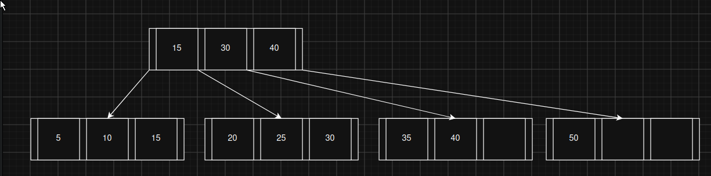
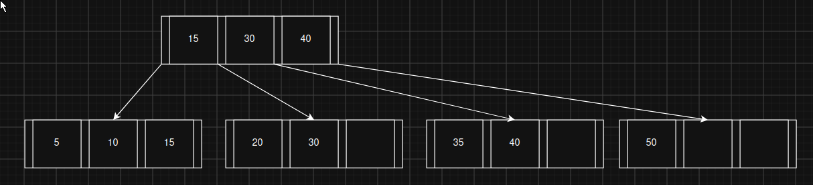

# Exercicio - Considere uma Árvore B+ de ordem 4 inicialmente vazia

## Questão A)

Insira as seguintes chaves em ordem.

- [5, 15, 25, 35, 45, 20, 30, 10, 50, 40]

## Questão B)

- [45, 25]

